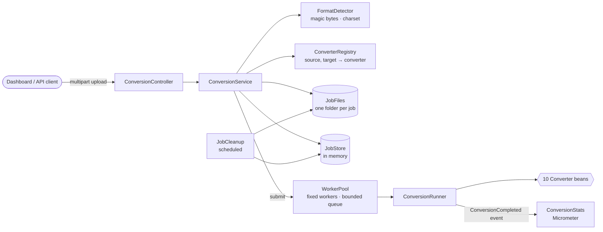

# BoostConvert mini

File conversion API in Java: upload a file, get a job, download the result. Ten conversions behind one interface, with the things that break a public upload endpoint handled on purpose: files that lie about their type, decompression bombs, traffic spikes and uploads that never get deleted.

[](https://github.com/Tutzdev/boostconvert-mini/actions/workflows/ci.yml)


> A Java rewrite of the core of [Boost.Convert](https://github.com/Boost-Convert-team/Boost.Convert), a file conversion SaaS I built with Python and Flask. Same brand, no accounts and no payments: only the conversion engine, built to be read.

## The problem

Converting a file looks like `read → transform → write`. Put it behind a public endpoint and it breaks quickly:

- A file named `invoice.png` is actually a PDF, or something worse. Trusting the extension or the browser's `Content-Type` sends it to the wrong library.
- A 2 MB PNG declares a 50,000 × 50,000 canvas. Decoding it allocates about 10 GB and takes the server down.
- Thirty people upload at the same time. Converting inside the request thread exhausts CPU and memory, and every request times out together.
- Uploads stay on disk forever, and they are personal data.
- The CSV came from Excel on a Brazilian Windows: semicolons, Windows-1252, and a ZIP code that must stay `01310`, not become `1310`.

## Backend highlights

- **Content sniffing instead of trust.** Magic bytes identify PNG, JPG, WebP, PDF and XLSX (a ZIP that contains `xl/workbook.xml`). The file name is only trusted to tell text formats apart, and a name that contradicts the content is a `415 FORMAT_MISMATCH`, decided before anything is queued.
- **Asynchronous jobs with backpressure.** An upload is answered with `202 Accepted` and a `Location`. A fixed pool of workers with a bounded queue runs the conversions. When the queue is full the API answers `429` with `Retry-After` instead of accepting work it cannot finish.
- **Limits on the decoded size, not only on the upload.** Image dimensions are read from the header and checked before any pixel is allocated. PDF pages are counted, and each page's bitmap size is checked, before rendering. CSV, JSON and XLSX conversions stop after a cell budget, and XLSX is read with SAX streaming instead of the workbook object model.
- **Immutable job state with atomic transitions.** `QUEUED → RUNNING → SUCCEEDED | FAILED` are methods on a record, applied by the store with `ConcurrentHashMap.computeIfPresent`. Readers never see a half-updated job, and a worker notices when the user deleted the job while it was converting.
- **One interface, ten classes.** Every conversion is a `Converter` bean. The registry indexes them by `(source format, target format)` and stops the application at startup if two converters claim the same route.
- **Private by default.** The upload is deleted as soon as the conversion ends, the result after 30 minutes (configurable) or right away with `DELETE`. Leftovers from a crash or a race are swept by age, and wiped at startup. No endpoint lists other people's jobs.
- **Safe downloads.** Results are always attachments, with `X-Content-Type-Options: nosniff` and `Content-Security-Policy: sandbox`. Markdown → HTML escapes raw HTML and drops `javascript:` links.
- **Errors as Problem Details (RFC 9457)** with a stable `code`, for HTTP errors and for failed jobs alike (`PDF_ENCRYPTED`, `IMAGE_TOO_LARGE`, `CSV_MALFORMED`...).
- **Observability.** Actuator health probes and Prometheus metrics: `boostconvert_conversions_seconds{converter, outcome}`, plus the worker pool (`executor_active_threads`, `executor_queued_tasks`) through Micrometer.

## Conversions

| Id | From → To | Engine | Behaviour |
| --- | --- | --- | --- |
| `png-to-jpg` | PNG → JPG | ImageIO | Transparent areas become white (JPG has no alpha channel). Quality 0.9. |
| `jpg-to-png` | JPG → PNG | ImageIO + TwelveMonkeys | CMYK JPGs from print workflows come out as RGB. |
| `webp-to-png` | WEBP → PNG | TwelveMonkeys | Keeps transparency; animations keep the first frame. |
| `image-to-pdf` | JPG, PNG → PDF | PDFBox | A4, landscape for wide images, scaled down but never up. JPG bytes are embedded without re-encoding. |
| `pdf-to-txt` | PDF → TXT | PDFBox | UTF-8 text layer. A scan without one fails with `PDF_HAS_NO_TEXT`. |
| `pdf-to-png` | PDF → PNG | PDFBox | 144 dpi. One page gives a PNG; several give a ZIP of `page-01.png`, `page-02.png`... |
| `md-to-html` | Markdown → HTML | commonmark-java | Standalone styled page with GitHub tables, strikethrough and autolinks. |
| `csv-to-json` | CSV → JSON | Commons CSV + Jackson | Detects `,` `;` tab or `\|`, reads UTF-8 or Windows-1252, keeps values as text, streams rows. |
| `json-to-csv` | JSON → CSV | Jackson + Commons CSV | Nested objects become `address.city`; the header is the union of every key. |
| `xlsx-to-csv` | XLSX → CSV | Apache POI (SAX) | Values as Excel displays them, formulas as their saved results. Several sheets give a ZIP. |

## Business rules

| Rule | Where it is enforced | Reported as |
| --- | --- | --- |
| The content decides the format; a name that contradicts it is rejected | `FormatDetector` | `415 FORMAT_MISMATCH` |
| Unknown extensions and unrecognisable content are rejected | `FormatDetector` | `415 UNSUPPORTED_FORMAT` |
| Text formats must be text (no NUL bytes), in UTF-8 or Windows-1252 | `FormatDetector` | `415 NOT_TEXT` |
| Only routes with a converter are accepted; the error lists the valid targets | `ConverterRegistry` | `422 CONVERSION_NOT_SUPPORTED` |
| Uploads are 1 byte to 20 MB | multipart config, `ConversionService` | `413 FILE_TOO_LARGE`, `400 EMPTY_FILE` |
| At most `workers + queue-capacity` jobs are pending | `WorkerPool` | `429 QUEUE_FULL` + `Retry-After` |
| Images up to 50 megapixels, checked from the header | `ImageFiles` | job `IMAGE_TOO_LARGE` |
| PDFs up to 300 pages; rendering up to 30 pages of 50 megapixels each | `PdfDocuments`, `PdfToPngConverter` | job `TOO_MANY_PAGES`, `PAGE_TOO_LARGE` |
| CSV, JSON and XLSX up to 1,000,000 cells | `CellBudget` | job `TOO_MANY_CELLS` |
| A CSV row cannot have more values than the header | `CsvToJsonConverter` | job `CSV_MALFORMED` |
| A result can only be downloaded from a job that succeeded | `ConversionService` | `409 RESULT_NOT_READY`, `409 RESULT_NOT_AVAILABLE` |
| Finished jobs and their files are deleted after the retention period | `JobCleanup` | `404 JOB_NOT_FOUND` afterwards |

"Job" codes are stored on the job and shown by `GET /api/v1/conversions/{id}`: the upload request was already answered with `202` when the converter found the problem. The same applies to `CORRUPT_FILE`, `PDF_ENCRYPTED`, `PDF_HAS_NO_TEXT`, `JSON_INVALID` and `JSON_SHAPE_UNSUPPORTED`.

## Architecture



One upload, from request to download:

1. `POST /api/v1/conversions` saves the upload as `<storage>/jobs/<id>/input`.
2. `FormatDetector` reads the magic bytes and decides the real format, and `ConverterRegistry` finds the converter for (format, target). Any problem is a 4xx right away, and the file is deleted.
3. The job is stored as `QUEUED` and handed to the `WorkerPool`. If the queue is full, the job is removed again and the client gets `429`.
4. A worker moves the job to `RUNNING`, streams the converter's output to `result`, deletes the input, and finishes the job as `SUCCEEDED` or `FAILED` with a code.
5. The client polls `GET /api/v1/conversions/{id}` and downloads `/result`. After 30 minutes `JobCleanup` deletes the record and the file.

```
src/main/java/dev/tutz/boostconvert
├── format        FileFormat, FormatDetector (magic bytes, name rules, charset)
├── converter     Converter interface, ConverterRegistry, limits, catalog endpoint
│   ├── image     PNG→JPG, JPG→PNG, WEBP→PNG, image→PDF, safe ImageIO decoding
│   ├── document  PDF→TXT, PDF→PNG, Markdown→HTML
│   └── data      CSV→JSON, JSON→CSV, XLSX→CSV (SAX), delimiter detection, cell budget
├── job           ConversionJob (immutable), JobStore, JobFiles, WorkerPool, ConversionRunner, cleanup, API
├── stats         per-converter counters, Micrometer timer, stats endpoint
└── common        Problem Details handler, ApiException, safe file names
```

## API

OpenAPI UI: `/swagger-ui.html`.

| Method | Path | Description |
| --- | --- | --- |
| `GET` | `/api/v1/converters` | The ten converters with their accepted extensions |
| `POST` | `/api/v1/conversions` | Multipart `file` and `target` (`jpg`, `pdf`, `csv`...). Answers `202` with `Location` |
| `GET` | `/api/v1/conversions/{id}` | Status, result metadata or error of a job |
| `GET` | `/api/v1/conversions/{id}/result` | Downloads the converted file |
| `DELETE` | `/api/v1/conversions/{id}` | Deletes the job and its files now |
| `GET` | `/api/v1/stats` | Aggregates for the dashboard: totals, queue and usage per converter |

```bash
curl -F file=@banner.webp -F target=png localhost:8080/api/v1/conversions
curl localhost:8080/api/v1/conversions/3a03505e-6edd-4a4d-a6fe-2f454bda8302
```

```json
{
  "id": "3a03505e-6edd-4a4d-a6fe-2f454bda8302",
  "converter": "webp-to-png",
  "status": "SUCCEEDED",
  "source": { "name": "banner.webp", "format": "webp", "mediaType": "image/webp", "sizeBytes": 48, "downloadUrl": null },
  "result": {
    "name": "banner.png", "format": "png", "mediaType": "image/png", "sizeBytes": 207,
    "downloadUrl": "/api/v1/conversions/3a03505e-6edd-4a4d-a6fe-2f454bda8302/result"
  },
  "error": null,
  "createdAt": "2026-10-09T20:51:10.348Z",
  "startedAt": "2026-10-09T20:51:10.351Z",
  "finishedAt": "2026-10-09T20:51:10.403Z",
  "expiresAt": "2026-10-09T21:21:10.403Z",
  "durationMs": 52
}
```

A WebP renamed to `.pdf` never reaches a worker:

```json
{
  "status": 415,
  "title": "Unsupported Media Type",
  "detail": "The file is named .pdf but its content is a WEBP file.",
  "instance": "/api/v1/conversions",
  "code": "FORMAT_MISMATCH",
  "timestamp": "2026-10-09T20:51:21.616Z"
}
```

## Technical decisions

- **Jobs instead of a synchronous endpoint.** Conversion time depends on the file, not on the request. `202` plus polling keeps HTTP threads short, makes the backpressure explicit and lets a client wait for a slow PDF without holding a connection open. The cost is one extra request per poll; a webhook or Server-Sent Events would remove it.
- **Platform threads for conversions, virtual threads for HTTP.** Converting is CPU bound, so more threads than cores only adds memory pressure. A small fixed pool keeps the machine predictable. The request side only does I/O and runs on virtual threads.
- **A bounded queue and `429` instead of an unbounded queue.** An unbounded queue hides overload until the heap runs out and every job is lost at once. A bounded one turns a few requests away clearly, with `Retry-After`.
- **Jobs in memory.** They live for minutes and their files sit on the local disk, so a database would add a dependency without adding durability. `JobStore` and `JobFiles` are the two pieces to move (to Redis and S3, for example) to run more than one instance.
- **CSV values stay strings.** Type guessing turns `01310` into `1310` and breaks `1.234,50`. The consumer knows which columns are numbers; the converter does not.
- **SAX for XLSX.** The workbook object model needs several times the file size in heap. The streaming reader keeps memory proportional to the cells actually written, and the cell budget caps that.
- **Only JVM libraries, no external binaries.** No LibreOffice or ffmpeg on the host: the jar runs anywhere and every converter is unit-testable. That is also why DOCX → PDF and audio or video are out of scope for the mini version.
- **An event between jobs and stats.** The runner publishes `ConversionCompleted` and the stats component listens, so the job package does not depend on the dashboard.

## Tests

```bash
./mvnw verify
```

63 tests, no Docker or external services needed:

- One test class per converter family, with input files built in code: a PNG with transparency, multi-page, blank and password-protected PDFs, XLSX with formulas and gaps, a CSV saved in Windows-1252. They check the output and every failure code.
- `FormatDetectorTest`: signatures, name and content mismatch, ZIP versus XLSX, charset fallback, binary content in a text file.
- `WorkerPoolTest`: a full queue rejects with `Retry-After` and counts the rejection.
- `ConversionJobTest`: the state machine only moves forward.
- `ConversionApiTests` (`@SpringBootTest` + `MockMvcTester`): upload, poll and download with its headers, failures stored on the job, immediate 4xx responses, delete, catalog and stats.

CI runs the suite, then builds the Docker image, starts it and converts a WebP inside the container.

## Running locally

```bash
./mvnw spring-boot:run        # http://localhost:8080
```

With Docker:

```bash
docker build -t boostconvert-mini .
docker run -p 8080:8080 boostconvert-mini
```

| Variable | Default | Meaning |
| --- | --- | --- |
| `PORT` | `8080` | HTTP port |
| `BOOSTCONVERT_WORKERS` | `2` | Conversions running at the same time, about one per core |
| `BOOSTCONVERT_QUEUE_CAPACITY` | `20` | Jobs that can wait for a worker before uploads get `429` |
| `BOOSTCONVERT_RETENTION` | `30m` | How long a finished job and its file are kept |
| `BOOSTCONVERT_STORAGE_DIR` | `<tmp>/boostconvert` | Where uploads and results live while a job exists |

The conversion limits (pixels, pages, cells, dpi, JPG quality) are under `boostconvert.limits` in `application.yml`.

## Interface

A dashboard in the Boost.Convert brand (plain HTML, CSS and JS served by Spring at `/`): drag-and-drop upload that offers only the valid targets for the file, a live list of this browser's jobs with download and delete, the converter catalog, and live queue and per-converter numbers.

## Next steps

- Redis for jobs and S3 for files, to run several instances behind a load balancer.
- Rate limiting per client; today the queue bound is global.
- Server-Sent Events or a webhook instead of polling.
- EXIF orientation for phone photos in JPG → PNG.
- Batch uploads, such as several images into one PDF.
